<div align="center">

# &locution

**Entraîne ta pensée. Trouve tes mots. Parle avec impact.**

### 👉 [**OUVRIR L'APPLICATION**](https://nassersalimou.github.io/elocution/) 👈

**https://nassersalimou.github.io/elocution/**

Gratuit · rien à installer · fonctionne dans Chrome ou Edge, sur ordinateur

</div>

---

## C'est quoi ?

&locution est une application d'entraînement à l'**expression orale**, en français.
On y travaille, par petits exercices chronométrés :

- la **rapidité de réflexion** sous pression (débat, entretien, imprévu) ;
- la **structure** des idées ;
- le **vocabulaire** actif ;
- la **diction** et le débit ;
- la **conscience de sa propre voix**.

Tu parles dans ton micro, tu t'écoutes, tu progresses : XP, niveaux, séries quotidiennes et badges.

## 🤖 Version avec IA : sur code d'accès

L'application a deux modes dans chaque jeu :

| | **Mode manuel** | **Mode Assistant IA** |
|---|---|---|
| Accès | ✅ Libre, pour tout le monde | 🔑 Sur **code d'accès** |
| Jeux, chronos, enregistrement de la voix | ✅ | ✅ |
| Retours | Auto-évaluation guidée | Bilan personnalisé de ta réponse (arguments, clarté, exemples) |
| Adversaire de débat | Arguments préparés | Un adversaire IA qui **répond à ce que tu viens de dire** |
| Voix | Voix du navigateur | Voix HD Google, très claire |
| Transcription de ce que tu dis | — | ✅ (y compris les « euh ») |

L'IA a un coût réel, c'est pourquoi elle est protégée par un code.

### 📩 Tu veux essayer l'IA ?

**[Envoie-moi un message ici](https://github.com/nassersalimou/elocution/issues/new?title=Demande%20de%20code%20d%27acc%C3%A8s%20IA&body=Bonjour%2C%20j%27aimerais%20essayer%20la%20version%20IA%20de%20%26locution.%0A%0AComment%20te%20contacter%20%3A%20)**
(un compte GitHub gratuit suffit), en indiquant comment te recontacter. Le code te sera transmis en privé.

Une fois le code reçu : **Réglages → Code d'accès IA → Enregistrer**, puis choisis **Assistant IA** dans un jeu.

---

## 📸 Aperçu

### Accueil
Ton tableau de bord : niveau, XP, série de jours, et accès direct aux entraînements.

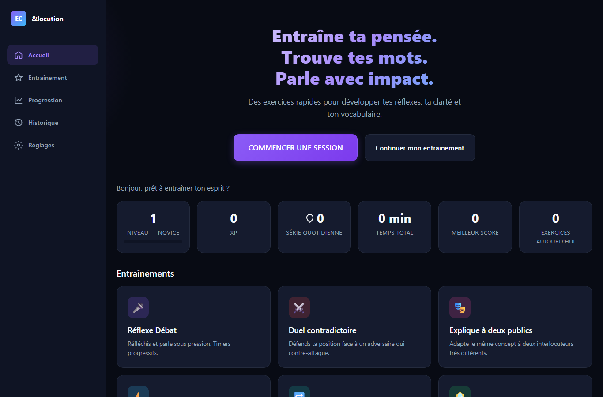

### Les entraînements
Sept jeux, plus une **session rapide de 5 minutes** qui en enchaîne quatre.

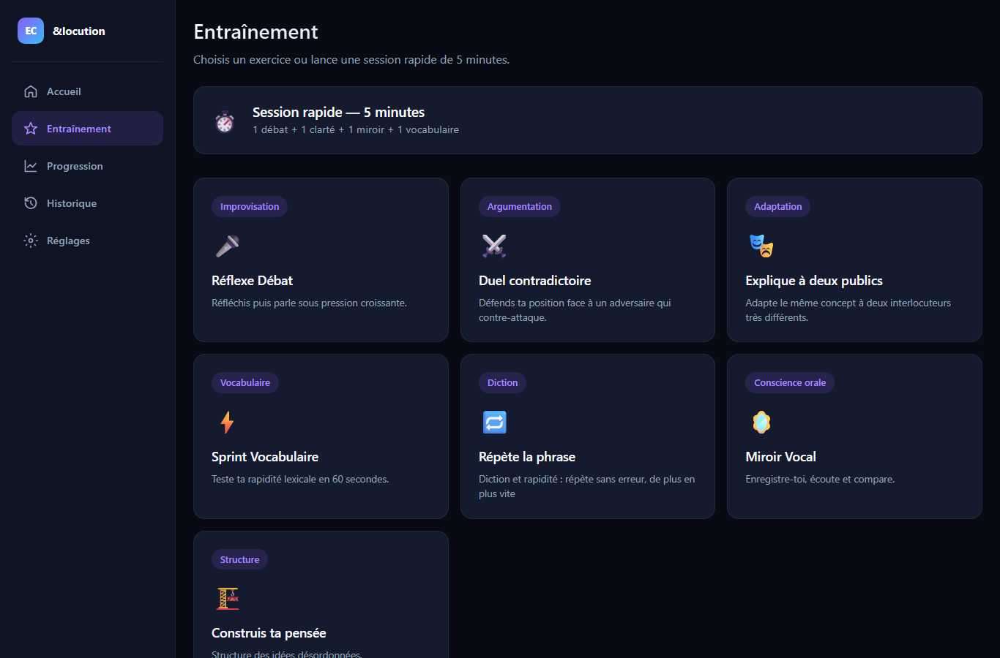

### Réflexe Débat
Un sujet, un temps de réflexion, puis tu réponds à l'oral. Les chronos raccourcissent à chaque manche.
Dix thèmes (débat, entretien d'embauche, pitch, culture générale…), quatre niveaux de difficulté et plus de 450 sujets.
En mode IA, un adversaire te répond à l'oral et tu dois lui répliquer.

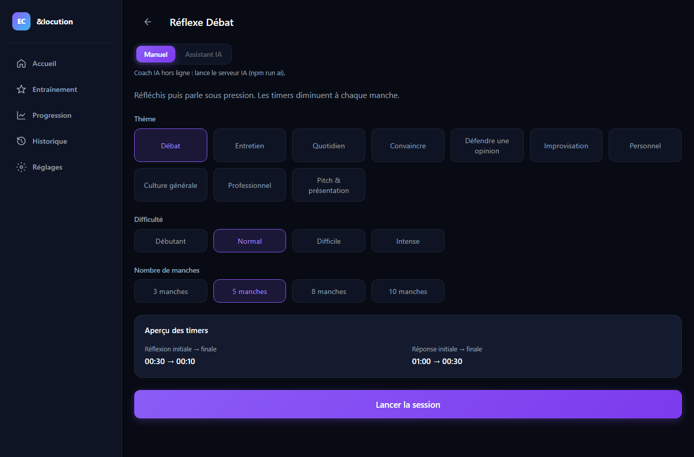

### Duel contradictoire
Tu choisis un sujet et ton camp, puis tu défends ta position face à un contradicteur qui attaque **tes** arguments.

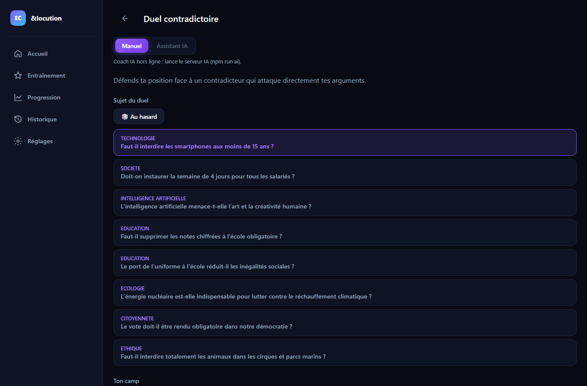

### Explique à deux publics
Le même concept à expliquer à deux personnes très différentes : un enfant puis un expert, par exemple.

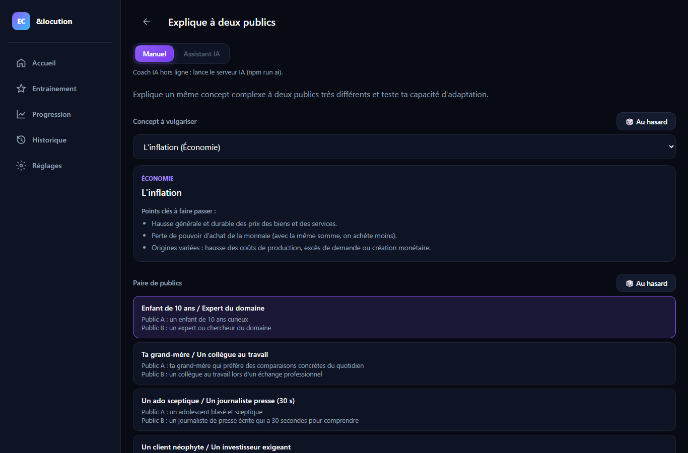

### Répète la phrase
Diction et rapidité : écoute une phrase, répète-la sans erreur avant la fin du temps. Dix niveaux, de plus en plus rapides.

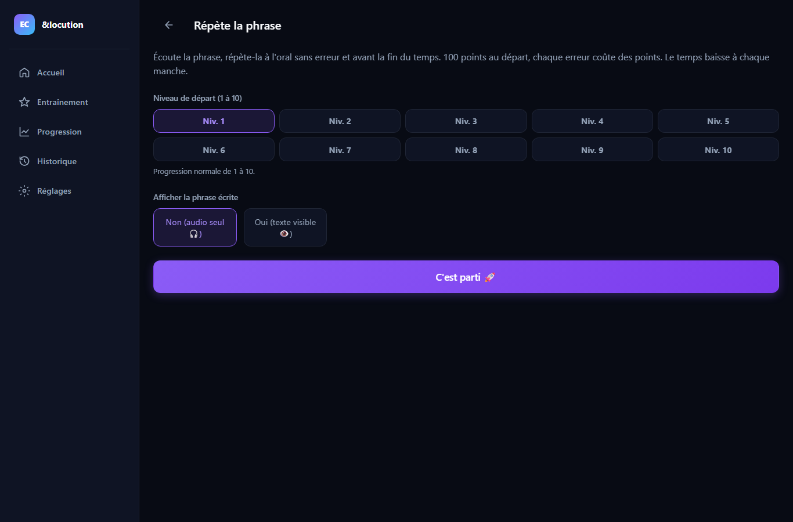

### Miroir Vocal
Une mission (« explique en 45 secondes comment tu gères le stress »), tu t'enregistres, tu t'écoutes, tu refais une prise et tu compares.

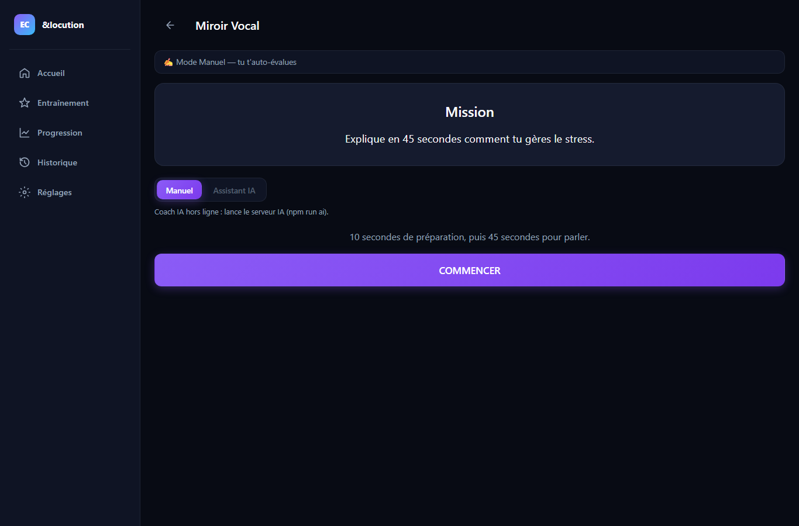

### Sprint Vocabulaire
60 secondes de synonymes, contraires, champs lexicaux et reformulations.

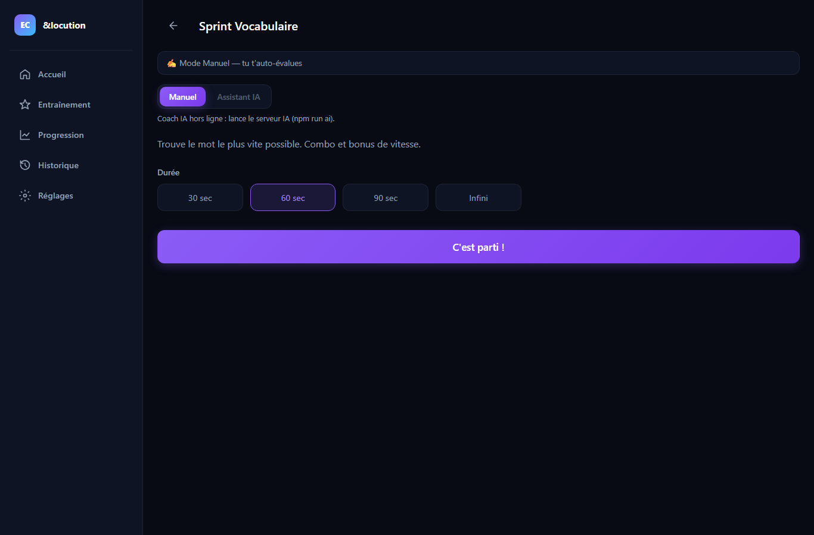

### Construis ta pensée
Des idées en vrac à transformer en réponse structurée.

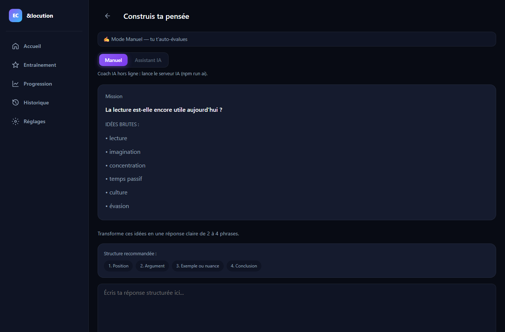

### Progression
Statistiques par compétence, temps d'entraînement et badges à débloquer.

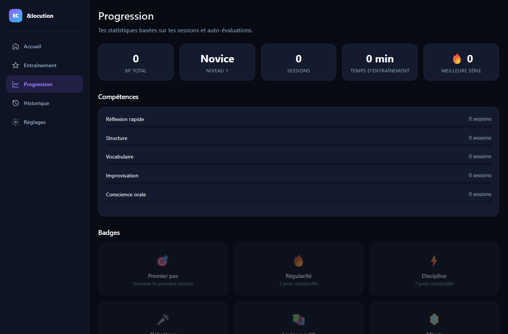

### Réglages
Choix de la voix (femme ou homme, vitesse) et **code d'accès IA**.

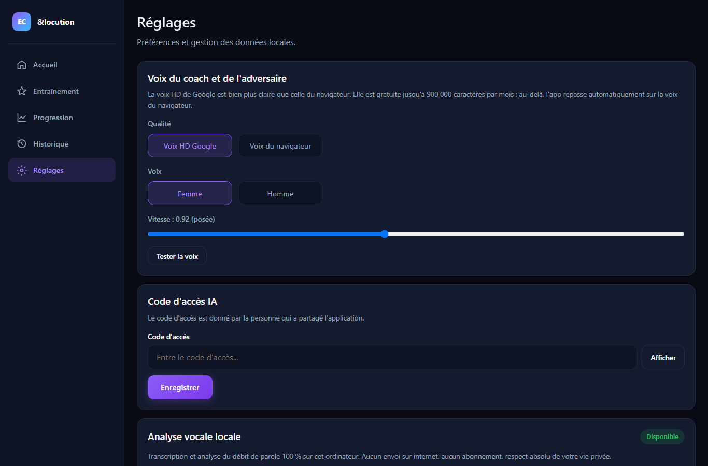

---

## 🔒 Vie privée

- Ta progression est enregistrée **uniquement dans ton navigateur** : pas de compte, pas d'inscription.
- En mode manuel, tes enregistrements restent sur ton ordinateur.
- En mode IA, ce que tu dis est envoyé au serveur IA le temps de l'analyse, pour produire ton bilan.

## 💡 Conseils

- Autorise le **micro** quand le navigateur le demande.
- Utilise **Chrome ou Edge** sur ordinateur, avec un casque si possible.
- Chaque bouton 🔊 **Écouter** lit le texte à voix haute (pratique pour les personnes malvoyantes).

---

## 🛠️ Pour les développeurs

Site : React 19 + Vite. Serveur IA : Python (FastAPI), Gemini sur Vertex AI, voix Google Text-to-Speech, Whisper pour l'analyse du débit. Hébergement : GitHub Pages (site) + Google Cloud Run (IA).

```bash
npm install
npm run dev        # site sur http://localhost:5173
npm test           # tests unitaires
```

Le serveur IA (`local-ai/`) tourne en local sur le port 8765 si aucune adresse `VITE_AI_URL` n'est définie. Il a besoin de ses propres identifiants Google Cloud (fichier `local-ai/.env`, non publié).
